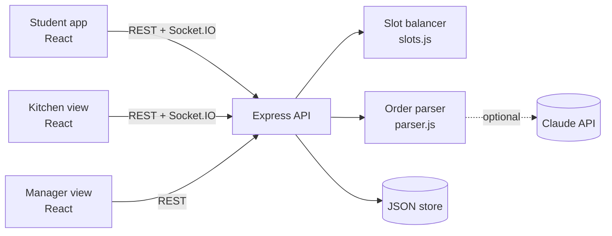

# QueueZero

**Skip the line, not the meal.** An AI pre-order system for college canteens: order in plain language (English, Hindi or Hinglish), pick a load-balanced pickup slot, and let the kitchen see exactly what to cook, live.

> Built for the hackathon problem: *"Long queues make students miss classes. Build a pre-order system with plain-language ordering, load-balanced pickup slots, and a live kitchen view."*

## What makes it different

| Feature | What it does |
|---|---|
| **Plain-language ordering** | Type or **speak** `2 masala dosa aur ek chai, no sugar`. Claude reads it when an API key is set; a built-in typo-tolerant Hinglish parser works offline, so the demo never breaks. Output is always validated against the real menu. |
| **Pickup board** | Slots are shown like a departure board. Ten blocks per row show how busy the kitchen will be in that window. |
| **Load-balanced slots** | Every dish has a prep cost. Each 10-minute slot has a capacity. Orders that don't fit are refused atomically (no double booking) and the UI offers the nearest slot with room. |
| **Class Guard** | Enter when your next class starts. QueueZero highlights the quietest slot that still gets you there, including a 4-minute walk. |
| **Rush Savers** | Choosing a quiet slot earns points and a place on the leaderboard. This nudges demand away from the peak instead of just reacting to it. |
| **Live kitchen view** | Socket.IO board (Incoming, On the stove, Ready), a sound alert for new orders, and a **cook list by pickup window** ("12× Masala Dosa for 11:10"). |
| **No-show auto-release** | Orders not collected 10 minutes after "Ready" release their slot automatically. |
| **Manager copilot** | Sales, student minutes saved, load chart, stock control, and AI (or rule-based) suggestions. |
| **Simulate a lunch rush** | One click fires 20 orders at the same three slots so judges can watch the balancer spread them out live. |

## Architecture



- **`server/src/slots.js`** is the heart: pure functions, fully unit tested.
- **`server/src/orders.js`** creates orders and enforces the status flow `PLACED → ACCEPTED → PREPARING → READY → PICKED_UP` (or `CANCELLED` / `NO_SHOW`).
- **Storage** is a debounced JSON file so the project runs with zero native dependencies. The data access is isolated in `store.js` and `orders.js`, so moving to PostgreSQL is a contained change.

### The balancing idea

```
load(order)  = Σ prep_units(item) × qty
slot.free    = capacity − Σ load(orders in slot)        # capacity = 40 units per 10 min
recommend()  = soonest | quietest | quietest that ends ≥ 4 min before your class
reflow()     = nearest slot with free ≥ load(order)
```

## Quick start

Requires **Node 18+** (Node 22 recommended).

```bash
git clone <your-repo-url> queuezero && cd queuezero
npm install          # installs root, server and client
npm run dev          # API on :4000, web on http://localhost:5173
```

Open three browser tabs to see the real-time flow:

1. **Order** tab: place an order.
2. **Kitchen** tab: PIN `1111`. Accept it and watch the student's ticket update.
3. **Manager** tab: PIN `2222`. Click **Simulate a lunch rush**.

### Turn on Claude (optional)

```bash
cp server/.env.example server/.env   # then set ANTHROPIC_API_KEY
```

Without a key the app uses the offline parser and rule-based insights. The header badge shows which mode is active.

### Production (single server)

```bash
npm run build && npm start     # Express serves client/dist on :4000
```

Deploys to Render, Railway or Fly as one web service. Build: `npm install && npm run build`. Start: `npm start`. Set `KITCHEN_PIN`, `MANAGER_PIN` and optionally `ANTHROPIC_API_KEY`. Note: free tiers have ephemeral disks, so the JSON store resets on redeploy (fine for a demo).

## Tests

```bash
npm test      # 15 tests: slot math, reflow, parser (Hinglish, typos, notes), order rules
```

## API

| Method | Path | Who | Purpose |
|---|---|---|---|
| GET | `/api/menu` | all | Menu with stock |
| POST | `/api/parse` | all | `{text}` → `{items, unmatched, source}` |
| GET | `/api/slots?need=&classStart=` | all | Slots with load plus recommendations |
| POST | `/api/orders` | all | Place an order (`409` if the slot filled up) |
| POST | `/api/orders/:id/cancel` | all | Cancel while `PLACED` or `ACCEPTED` |
| PATCH | `/api/orders/:id/status` | kitchen | Advance status |
| GET | `/api/kitchen` | kitchen | Open orders |
| GET | `/api/stats`, `/api/insights` | manager | Analytics and suggestions |
| PATCH | `/api/menu/:id` | manager | Stock and availability |
| POST | `/api/demo/rush` | manager | Simulate a rush |

Socket events: `order:new`, `order:update`, `slots:changed`, `menu:changed`.

## 3-minute demo script

1. **Problem** (20s): "Peak-hour queues cost students 10 to 15 minutes, so they skip meals or walk into class late."
2. **Speak an order** (30s): tap *Speak*, say "do masala dosa aur ek chai". Show it landing in the tray.
3. **Class Guard** (30s): set your next class time and tap *Pick the best time for me*.
4. **Place it** (20s): the kitchen tab beeps and the order appears.
5. **Rush** (60s): in Manager, tap *Simulate a lunch rush*. Show the load chart staying under capacity and the "moved to quieter slots" count.
6. **Close** (20s): student minutes saved, no-show auto-release, and the roadmap below.

## Project structure

```
queuezero/
├─ server/
│  ├─ src/ index.js  slots.js  orders.js  parser.js  ai.js  stats.js  store.js  menu.js
│  └─ test/ slots.test.js  orders.test.js  parser.test.js
├─ client/
│  └─ src/ App.jsx  Student.jsx  Kitchen.jsx  Manager.jsx  Board.jsx  Tracker.jsx  api.js  styles.css
└─ .github/workflows/ci.yml
```

## Known limits (and what we'd do next)

- Auth is a staff PIN and a typed student name. Next: college email or phone OTP with JWT.
- Payment is at the counter. Next: UPI/Razorpay with webhook verification.
- Next: web push or WhatsApp "your order is ready", timetable-aware slot suggestions, PostgreSQL, and per-dish demand forecasting from order history.

## Team

| Name | Role | GitHub |
|---|---|---|
| _Member 1_ | Backend and slot algorithm | @username |
| _Member 2_ | Frontend and UX | @username |
| _Member 3_ | AI, demo and pitch | @username |

MIT licensed.
